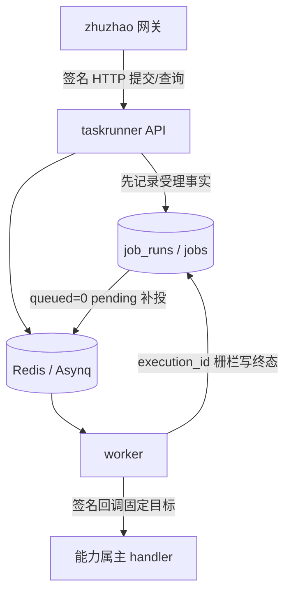

# taskrunner 运行设计

当前实现 = 独立 HTTP API、PostgreSQL/SQLite 执行事实库与 Redis/Asynq 队列。服务负责调度、重试和记录，业务 handler 由回调对端持有。当前接入方为 zhuzhao。能力目录已获批准但未实施，见 [规划](capability-registry.md)；历史方案见 [归档](../review/archive/taskrunner-design-history.md)。

2026-11-13新增的统一能力通道/数据互通愿景见[平台集成合同](platform-integration.md#统一能力通道中的tr边界)和主仓[权威合同](../../../zhuzhao/docs/design/capability-invocation-contract.md)，均为设计。TR继续作为业务任务调度与投递写主；统一入口不要求所有查询和本地短事务经队列，执行callback也不等于结果已回贴到工单或AL。当前源码和下述实现限制保持。

## 调用与数据归属

动作 `action` 是对端注册的业务操作；任务定义 `job` 记录 `action_id`、cron/manual、参数、启停和标签；每个 `task_id` 在 `job_runs` 只有一行，重试更新 `attempts`，不是每次尝试另建 run。自增 `id` 是查询序号，`execution_id` 是每次 delivery 的内部写入身份，不进入 HTTP API。

回调地址来自 `internal/config/config.go` 的 `Config.CallbackTargetURL`（环境变量 `TASKRUNNER_CALLBACK_TARGET_URL`）。`internal/service/task_service.go` 的 `TaskService.Submit`、`CreateJob` 拒绝非空用户 `callback_url`，`PatchJob` 拒绝传入该字段的指针值。多目标动作目录不属于当前能力；部署、密钥环可以配置，不能据此宣称已支持按 action 动态选址。

## DB-first 受理与恢复

`internal/service/submit.go` 的 `Service.Submit` 先持久化载荷和 `queued=0`，再尝试入 Redis；入队失败仍是已受理，Reclaim 负责补投。`job_runs` 兼任本服务的 outbox，不是业务平台通用事件 Outbox。准确状态和指纹见 [ADR-004](../adr/adr-004-db-first-outbox-reclaim.md)。

Redis 丢失后仅 `queued=0 + pending` 可自动重建；`queued=1 + pending` 告警待人工对账，`running` 等不会被任意自动重投。取消的 `queued=0` 行可在部分 Redis 故障下降级标记取消；`queued=1` 需要队列协作。清理数据前必须保证 DB 行生命周期覆盖对应 Redis TaskID 键与 retention 留观期，不能因为默认留存时间到了就删事实行。

## 执行、重试与并发

worker 固定并发池同步等待 HTTP 回调。2xx 表示动作完全成功；4xx 为不可重试失败；5xx、超时和回调边界 panic 按既有重试策略处理，最终失败进入 dead。回调可能已执行却响应丢失，因此交付是 at-least-once，属主必须幂等。

每次 delivery 生成新 `execution_id`；`internal/worker/worker.go` 的 `Deps.handleCallback` 取得执行权，终态更新通过 repository 的 `MarkRunning` / `Finish` 匹配身份、attempt 和状态。旧 delivery 被拒后不发送死信通知。此栅栏保护执行库，不保证跨 DB/HTTP exactly-once；MarkRunning 缺行或 DB 故障时继续回调并留日志的既有受容边界仍在。升级不能混跑旧 writer，见 [部署](../ops/deployment.md)。

cron/reclaim 以单 tick 捕获 panic 并记 Error 堆栈，下一轮继续；notifier 以单通知捕获，后续通知独立。进程致命错误、任意回调外程序故障与数据库持续失败不在该恢复承诺内。多副本 worker 可共享队列；当前 cron tick 的多副本重复触发防护仍需部署前单独落实，不能将队列原子取任务等同定时生成任务防重。

## 权限、标签与日志

服务间调用走 utils AK/SK 验签，用户权限归 zhuzhao；`dept` 是不透明筛选标签，当前共享任务队列全员可见，“只看我提交的”也是筛选。taskrunner 没有部门树、用户行级授权或 per-caller 标签隔离。`created_by` / `submitted_by` / `source_ip` 用于归因，不能当权限校验。

业务审计和提交凭证归 zhuzhao，执行事实归 `job_runs`，过程细节归 JSON Lines 应用日志，以 request_id/task_id/action/attempt 关联。参数和回调报文当前可能全量落日志，错误片段截断 1KiB；敏感参数应在进入共享队列前禁止，脱敏不是已经启用的保证。日志经 logger 文件+stdout 双写，默认文件轮转 100MiB、90天；实际旋钮见 `internal/config/config.go`。

## 已有运维入口与后续项

当前提供 `/healthz`、`/readyz`、执行记录和死信 API；没有 `/monitor` 路由和内嵌 asynqmon。`internal/notify/notifier.go` 的 notifier 已实现，配置 `TASKRUNNER_NOTIFY_*` 后尽力异步发送终败事件；目标未配置则不启用，通知失败不新建重试队列，也不影响执行终态。zhuzhao 接收入口为 `/internal/notify/dead-letter`。

审计归档是最初验收动作，后来 zhuzhao 已可本地调度；启用本地归档时须停掉本仓同名 cron 定义，防重复调度。完整时点与原失败见 [历史](../review/archive/taskrunner-evolution.md)。指标、运行事实清理、多目标目录、优先级队列、延迟任务与脚本能力须按各自批准/触发状态启动，不能因历史计划 M1–M4 名称就视为全部交付。

## 装配边界

`internal/handler` → `internal/service` → `internal/repository`；回调在 `internal/callback`、worker 在 `internal/worker`，生命周期在 `internal/app/app.go` 的 `App.Run`。本仓 `wire_gen.go` 是当前维护的装配源，`wire.go` 已删除；这不是自动重新生成 Wire 的承诺，也不代表 zhuzhao 主仓采用同样惯例。CLI enqueue 手工装配。API 与字段见 [契约](../api/contract.md)。
